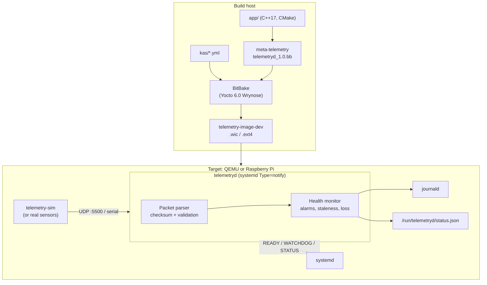

# Embedded Linux Telemetry Monitor

A C++17 telemetry service packaged into a custom embedded Linux image with the
Yocto Project. The service receives sensor packets over UDP or a serial port,
validates them, tracks the health of each sensor and runs under systemd with a
watchdog. A custom layer cross-compiles it, packages it, creates its service
account, enables it at boot and ships its tests to the target, and the image
boots in QEMU or on a Raspberry Pi.



## What this project demonstrates

| Skill | Where to look |
|---|---|
| Custom Yocto layer: `layer.conf`, dependencies, release compatibility | [`meta-telemetry/conf/layer.conf`](meta-telemetry/conf/layer.conf) |
| BitBake recipe with `cmake`, `systemd`, `useradd` and `ptest` classes | [`telemetryd_1.0.bb`](meta-telemetry/recipes-telemetry/telemetryd/telemetryd_1.0.bb) |
| Package splitting (`telemetryd`, `telemetryd-sim`, `telemetryd-ptest`) | same recipe, `PACKAGES` / `FILES` |
| Per-machine files through `FILESOVERRIDES` (Raspberry Pi config) | [`files/rpi/telemetryd.conf`](meta-telemetry/recipes-telemetry/telemetryd/files/rpi/telemetryd.conf) |
| Image recipes and image features, dev image built on a production one | [`recipes-telemetry/images/`](meta-telemetry/recipes-telemetry/images) |
| Reproducible build setup with kas, QEMU and Raspberry Pi targets | [`kas/`](kas) |
| Automated on-target testing: OEQA `testimage` and ptest | [`lib/oeqa/runtime/cases/telemetryd.py`](meta-telemetry/lib/oeqa/runtime/cases/telemetryd.py), [`run-ptest`](meta-telemetry/recipes-telemetry/telemetryd/files/run-ptest) |
| systemd: `Type=notify`, watchdog, reload, sandboxing, unprivileged user | [`telemetryd.service`](meta-telemetry/recipes-telemetry/telemetryd/files/telemetryd.service) |
| Linux APIs: `poll`, `signalfd`, `timerfd`, UDP sockets, `termios`, `sd_notify` protocol by hand | [`app/src/daemon/`](app/src/daemon), [`app/src/platform/`](app/src/platform) |
| Testable C++: platform-independent core, injected time, GoogleTest | [`app/src/core/`](app/src/core), [`app/tests/`](app/tests) |
| Cross-compilation outside Yocto (CMake toolchain file, arm64 under QEMU user mode) | [`aarch64-linux-gnu.cmake`](app/cmake/toolchains/aarch64-linux-gnu.cmake) |
| CI: sanitizers, two compilers, cross build, full image build + boot test | [`.github/workflows/`](.github/workflows) |

## Repository layout

```
app/                         the application (builds on its own with CMake)
  include/telemetry/         public headers of the portable core library
  src/core/                  packet parser, line buffer, health monitor, config, status JSON
  src/platform/              Linux layer: UDP, serial/termios, logging, sd_notify
  src/daemon/                telemetryd: event loop and command line
  src/sim/                   telemetry-sim: traffic generator with fault injection
  tests/                     GoogleTest unit tests + end-to-end integration test
meta-telemetry/              the Yocto layer (see its README)
kas/                         build configurations: common, qemux86-64, raspberrypi, ci
scripts/                     host setup, QEMU launcher, host-side simulator
.github/workflows/           app CI (every push) and Yocto image build (on demand)
```

## 1. Try the application on your PC (2 minutes)

Any Linux machine with a C++17 compiler and CMake 3.20+:

```sh
cmake -S app -B build -DTELEMETRY_BUILD_TESTS=ON
cmake --build build -j
ctest --test-dir build --output-on-failure        # 44 unit tests + integration test

# terminal 1: the daemon
./build/telemetryd --udp-port 5500 --status-file /tmp/status.json

# terminal 2: three simulated sensors with faults and a temperature spike every 20 s
./build/telemetry-sim --sensors 3 --rate 2 --fault-rate 0.05 --drop-rate 0.02 --spike-every 20
```

Watch terminal 1 for `ALARM`/`CLEAR` lines, packet-loss warnings and the
periodic report, and `cat /tmp/status.json` for the machine-readable state.
Send `kill -HUP` to reload a config file passed with `--config`.

## 2. Build the Yocto image

### Host requirements

- An x86-64 Linux machine. Ubuntu 22.04, 24.04 and 26.04 are among the
  distributions Yocto 6.0 supports; on Windows, use WSL2 with the image stored
  inside the Linux filesystem.
- Disk and memory: the Yocto Project's published guidance for 6.0 (32 GB RAM,
  140 GB disk) covers builds that include LLVM. This image doesn't build LLVM
  and turns on `rm_work`, so it needs considerably less, but leave generous
  headroom. More CPU cores shorten the build roughly linearly.
- The first build takes from under an hour to several hours depending on your
  machine and how much it can reuse from the Yocto Project's shared-state
  cache. Later builds only rebuild what changed and take minutes.

### One-time setup (Ubuntu)

```sh
./scripts/setup-host-ubuntu.sh
```

This installs Yocto's host packages, generates the `en_US.UTF-8` locale,
installs [kas](https://kas.readthedocs.io), and on Ubuntu 24.04+ lifts the
AppArmor restriction on unprivileged user namespaces that BitBake relies on
(read the comment in the script first if this is a shared machine).

### Build

```sh
kas build kas/qemux86-64.yml
```

kas clones BitBake, OpenEmbedded-Core, meta-yocto and meta-openembedded at the
`wrynose` (Yocto 6.0 LTS) branches next to this file, writes
`build/conf/local.conf` and `bblayers.conf`, and runs
`bitbake telemetry-image-dev`. The result lands in
`build/tmp/deploy/images/qemux86-64/`.

To get a BitBake shell for manual work (`bitbake -e`, `devtool`, ...):

```sh
kas shell kas/qemux86-64.yml
```

## 3. Boot it in QEMU and look around

```sh
./scripts/run-qemu.sh            # Ctrl-a x quits QEMU
```

Log in as `root` (no password: this is the development image). Then:

```sh
systemctl status telemetryd          # STATUS line comes from the daemon over sd_notify
journalctl -u telemetryd -f          # reports, ALARM/CLEAR events, packet loss
cat /run/telemetryd/status.json      # per-sensor state as JSON
systemctl reload telemetryd          # SIGHUP: re-read /etc/telemetryd/telemetryd.conf
ptest-runner telemetryd              # unit + integration tests, on the target
```

See the watchdog work: freeze the daemon and systemd restarts it after 10 s.

```sh
kill -STOP $(pidof telemetryd)
sleep 20; journalctl -u telemetryd -n 8 --no-pager   # "Watchdog timeout", then a restart
```

From a second terminal on the host:

```sh
ssh -p 2222 root@127.0.0.1           # forwarded by QB_SLIRP_OPT in kas/qemux86-64.yml
./scripts/send-from-host.sh          # adds sensors host-01 and host-02 via UDP port 5500
```

## 4. Raspberry Pi

```sh
kas build kas/raspberrypi.yml                          # Raspberry Pi 4 (64-bit)
KAS_MACHINE=raspberrypi2 kas build kas/raspberrypi.yml # e.g. a Raspberry Pi 2 Model B
```

Flash `build/tmp/deploy/images/<machine>/telemetry-image-dev-<machine>.rootfs.wic.bz2`
with `bmaptool copy` (the `.wic.bmap` file next to it makes this fast) or
Raspberry Pi Imager. On the Pi:

- The serial console is on GPIO pins 8 (TX) and 10 (RX) at 115200 baud.
- The Pi gets its own `/etc/telemetryd/telemetryd.conf` from
  `files/rpi/`, which also reads sensors from a USB-UART adapter at
  `/dev/ttyUSB0`. Plug one in at any time; telemetryd retries every 5 seconds.
- Anything that prints packet lines works as a sensor, e.g. a
  microcontroller, or `telemetry-sim --output /dev/ttyUSB1` on another machine
  connected through a second adapter.

## 5. Testing

| Level | What runs | How |
|---|---|---|
| Unit | 44 GoogleTest cases for parser, line buffer, health monitor, config, JSON | `ctest --test-dir build` |
| Integration | real daemon + simulator over localhost; checks counts, loss accounting, clean SIGTERM | `ctest -R integration` |
| On target (ptest) | both of the above, cross-compiled, on the image | `ptest-runner telemetryd` |
| Image (OEQA) | boots QEMU, checks ssh, systemd, then `telemetryd.py`: service active, runs unprivileged, watchdog set, data flowing, reload, ptests | `kas build kas/ci.yml -c testimage` |
| CI | all of the above, plus sanitizers, clang + gcc, arm64 cross build | GitHub Actions |

The Yocto workflow runs on demand (Actions → *Yocto image* → *Run workflow*)
and for `v*` tags, because a cold image build takes hours on a hosted runner.

## 6. Developing with devtool

```sh
kas shell kas/qemux86-64.yml
devtool modify telemetryd          # source workspace you can edit
devtool build telemetryd           # cross-compile just this recipe
devtool deploy-target -P 2222 telemetryd root@127.0.0.1   # push into the running QEMU
devtool reset telemetryd
```

## Wire protocol

One ASCII line per packet, NMEA-style:

```
$TLM,<sensor_id>,<seq>,<temp_c>,<humidity_pct>,<voltage_v>*<XX>
$TLM,env-01,42,23.50,41.2,3.29*0B
```

`XX` is the XOR of every byte between `$` and `*`, as two hex digits.
`sensor_id` is 1-32 characters of `[A-Za-z0-9_-]`; `seq` is a 32-bit counter
that wraps. A gap in `seq` counts as lost packets; a jump backwards counts as
the node restarting. Lines are rejected for framing, checksum, field count,
number format or physically impossible values, and each reason is counted.

## Configuration

`/etc/telemetryd/telemetryd.conf` (example with comments:
[`app/config/telemetryd.conf.example`](app/config/telemetryd.conf.example)).
Command-line options override the file. Unknown keys and bad values are
errors; at startup the service exits with status 78 (`EX_CONFIG`) and systemd
does not restart-loop; on reload the running configuration is kept.

| Key | Default | Meaning |
|---|---|---|
| `udp_bind`, `udp_port` | `0.0.0.0`, `5500` | UDP input; port 0 disables it |
| `serial_device`, `serial_baud` | empty, `115200` | serial input; empty disables it |
| `temp_high_c`, `temp_low_c` | `70`, `-10` | temperature alarm limits (1 °C hysteresis) |
| `humidity_high_pct` | `90` | humidity alarm limit (2 % hysteresis) |
| `voltage_low_v` | `3.0` | supply voltage alarm limit (0.05 V hysteresis) |
| `stale_timeout_ms` | `5000` | silence before a sensor is reported stale |
| `report_interval_s` | `10` | journal summary interval |
| `status_file` | `/run/telemetryd/status.json` | JSON status, rewritten atomically every second |
| `max_sensors` | `32` | cap on distinct sensor IDs (bounds memory) |
| `log_level` | `info` | `debug`, `info`, `warning`, `error` |

## Design notes

- **One thread, one `poll()` loop.** Signals arrive through `signalfd` and the
  1 s tick through `timerfd`, so nothing runs in signal-handler context and
  nothing needs locks.
- **No libsystemd dependency.** The `sd_notify` protocol is a datagram on a
  Unix socket, implemented in ~40 lines; journald priorities come from the
  `<N>` line prefix, used only when stderr really is the journal
  (`JOURNAL_STREAM`).
- **Portable core, thin platform layer.** Parsing and health logic take time
  as a parameter and never touch the OS, so the unit tests are fast and
  deterministic and run on the target unchanged.
- **Bounded resources.** Overlong serial lines are discarded, UDP reads are
  batched, and the sensor table has a fixed cap, so malformed or hostile input
  cannot grow memory or starve the event loop.
- **Fails safe.** A bad config refuses to start (or keeps the old one on
  reload); a missing serial adapter is retried rather than fatal; status
  files are written via rename so readers never see half a document.
- **Production vs development image.** `telemetry-image` has no passwordless
  root; `telemetry-image-dev` `require`s it and adds the simulator, tests,
  tools and debug logins.

## Troubleshooting

| Symptom | Fix |
|---|---|
| `User namespaces are not usable by BitBake, possibly due to AppArmor` | Ubuntu 24.04+: run `scripts/setup-host-ubuntu.sh` or see its comment |
| `Please make sure locale 'en_US.UTF-8' is available` | `sudo locale-gen en_US.UTF-8` |
| Build stops for lack of disk space | free space, or point `DL_DIR`/`SSTATE_DIR` at a bigger disk (kas passes them through) |
| QEMU is very slow | make `/dev/kvm` accessible (`sudo usermod -aG kvm $USER`, log in again) |
| Slow first build | normal; keep `build/`, `downloads/` and `sstate-cache/` between builds |
| `Fetcher failure` for a layer | check network access to `git.openembedded.org` and `git.yoctoproject.org` |

## License

MIT, see [`app/LICENSE`](app/LICENSE).
